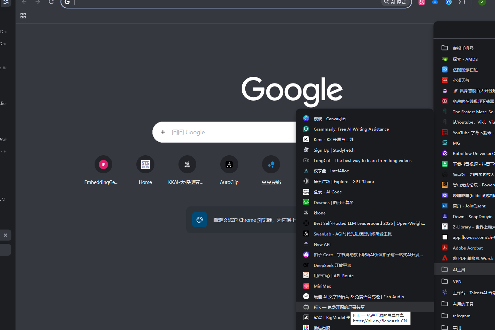

# EmbeddingGemma 2 · 本地语义检索

llama.cpp 出向量，React 提供界面。两种形态共用同一套前端与检索逻辑：

- **桌面应用**（推荐）：Electron 壳，双击即用，自带运行时与模型，不依赖 Python/Node 环境
- **服务器模式**：FastAPI 后端 + 浏览器访问，适合局域网共享

界面是左右两栏：左侧上传区与文档库（块数 / 体积 / 删除），右侧检索面板——三种任务模式、返回条数、MRL 维度切换，结果卡带 cosine 分数条、文件名、块序号、命中高亮，可展开全文、复制、「只看该文档」。




## 桌面应用（跨平台）

```
desktop/
├── package.json          Electron 45 + electron-builder
├── electron-builder.yml   默认包（内置模型）：win/mac/linux 打包配置
├── electron-builder.slim.yml     轻量包（不含模型，首次启动下载）
├── build/                  icon.ico / icon.png / entitlements.mac.plist
├── src/main/             主进程
│   ├── main.js             生命周期、窗口、菜单、单实例
│   ├── llama.js            拉起 llama-server（自动挑端口、等就绪、退出清理）
│   ├── api.js              本地 HTTP：/api/* + 托管前端
│   ├── store-sqlite.js     SQLite 向量库（与服务器端同 schema）
│   ├── chunk.js            切块（与 Python 版同规则）
│   ├── download.js         首次启动下载 GGUF（进度）
│   └── paths.js            数据/资源目录解析
├── src/setup/setup.html  首次启动向导（缺模型时）
├── src/preload/preload.js  contextBridge API
├── scripts/fetch-runtime.mjs   按平台取 llama.cpp（+ --with-model）
├── scripts/selfcheck.js        无界面端到端自检
└── resources/             runtime/ 与 models/（gitignore，构建前拉取）
```

```bash
cd desktop
npm install                 # 首次
npm run fetch-runtime       # 取当前平台的 llama.cpp；加 --with-model 顺带下 GGUF
npm run selfcheck           # 不起窗口，验证 推理 + 上传 + 检索
npm start                   # 开发运行（需正常桌面会话）
npm run dist:win            # 打包（默认内置模型）；另有 dist:mac / dist:linux
npm run dist:win:slim       # 轻量包（不含模型，首次启动下载）
```

打包前先 `build\build.ps1` 产出 `release\web`，图标由 `python build\make-icon.py` 生成到 `desktop\build\`。
**默认包内置模型**，装好即可用、完全离线；产物在 `release\desktop\`：

| 产物 | 体积 | 说明 |
|---|---|---|
| `EmbeddingGemma2-<v>-win-x64.zip` | ~467 MB | **含 GGUF**，解压后先跑 `Install.cmd`，首次启动无需联网 |
| `EmbeddingGemma2-<v>-win-slim-x64.zip` | ~198 MB | 不含模型，首次启动向导下载（约 310 MB） |

> ⚠️ **必须用 `Install.cmd` 启动，或解压到纯英文路径**。Chromium 在含中文的路径/工作目录下会
> 静默退出（双击 exe 毫无反应），这是 Electron 的已知行为。`Install.cmd` 会把程序（含内置模型）
> 复制到 `%LOCALAPPDATA%\Programs\EmbeddingGemma2` 并建桌面快捷方式。
> 细节与其它故障见 [docs/TROUBLESHOOTING.md](docs/TROUBLESHOOTING.md)。


> ⚠️ **必须用 `Install.cmd` 启动，或解压到纯英文路径**。Chromium 在含中文的路径/工作目录下会
> 静默退出（双击 exe 毫无反应），这是 Electron 的已知行为。`Install.cmd` 会把程序复制到
> `%LOCALAPPDATA%\Programs\EmbeddingGemma2` 并建桌面快捷方式。
> 细节与其它故障见 [docs/TROUBLESHOOTING.md](docs/TROUBLESHOOTING.md)。

```bash
npx electron-builder --dir       # 只出免安装目录（最快，CI 友好）
npx electron-builder --win zip   # 免安装 zip（本仓库产出的就是这种）
npx electron-builder --win nsis  # 需要 NSIS；受限环境可能因 makensis mmap 失败
```

签名/公证：配置已就位（无证书自动跳过），步骤见 [docs/SIGNING.md](docs/SIGNING.md)。


## 服务器模式

```cmd
build\build.ps1          :: 构建前端到 release\web（首次会 npm install）
deploy\start-ui.cmd      :: 起模型 + 后端，打开 http://127.0.0.1:8000
deploy\stop-ui.cmd       :: 全部停止
```

## 工程结构

```
embeddinggemma2-search/
├── desktop/            Electron 桌面壳 + Node 后端（见上）
├── backend/            服务器模式后端（FastAPI）
│   ├── app/
│   │   ├── config.py       路径、模型参数、prompt 前缀
│   │   ├── db.py           SQLite schema / 连接 / 变更令牌
│   │   ├── chunking.py     文本抽取 + 段落感知切块
│   │   ├── embeddings.py   llama-server 客户端（批量 /v1/embeddings）
│   │   ├── index.py        进程内向量矩阵 + 余弦 top-k
│   │   └── main.py         路由、上传、检索、静态托管
│   ├── run.py              启动入口（deploy/serve-api.cmd 调用）
│   ├── requirements.txt
│   └── lib/                依赖（pip --target，免 venv，gitignore）
├── frontend/           前端源码（React 19 + Vite + TS + Tailwind）
│   ├── src/                App / components / ui / api
│   ├── vite.config.ts      构建产物 -> ../release/web
│   └── package.json
├── build/              构建与打包
│   ├── build.ps1           前端构建 + 后端导入自检
│   ├── package.ps1         打 zip（可 -WithRuntime 含模型）
│   ├── cache/              下载/安装缓存（gitignore）
│   └── out/                打包产物（gitignore）
├── release/            可运行产物
│   ├── web/                前端构建结果（两种模式共用）
│   ├── desktop/            桌面安装包（gitignore）
│   ├── models/             GGUF（310 MB，gitignore）
│   └── runtime/            llama.cpp Windows 预编译（gitignore）
├── deploy/             服务器模式运维
│   ├── start-ui.cmd        一键起模型 + 后端 + 打开浏览器
│   ├── stop-ui.cmd         一键全停
│   ├── start.cmd           只起模型（前台）
│   ├── start-bg.cmd        只起模型（后台）
│   ├── stop.cmd            只停模型（按端口）
│   ├── serve-api.cmd       只跑后端
│   ├── download.cmd        拉取 llama.cpp 与 GGUF
│   └── health.py / fetch.py / smoke_test.py / ingest_samples.py
├── data/               运行数据（gitignore）
├── docs/               补充文档与截图
├── samples/            示例语料（中文 FAQ / 设计笔记 / 代码）
└── logs/               运行日志（gitignore）
```


## 快速开始

```cmd
build\build.ps1          :: 构建前端到 release\web（首次会 npm install）
deploy\start-ui.cmd      :: 起模型 + 后端，打开 http://127.0.0.1:8000
deploy\stop-ui.cmd       :: 全部停止
```

没有模型/运行时（新克隆）时先执行：

```cmd
deploy\download.cmd      :: 拉 llama.cpp b12360 + embeddinggemma-2-Q8_0.gguf 到 release\
```

> 本机 `curl` 的 schannel 已损坏，所有下载走 `deploy/fetch.py`（Python + hf-mirror）。

## 各层职责

| 层 | 负责 | 不负责 |
|---|---|---|
| `release/runtime` | 纯推理进程，OpenAI 兼容 `/v1/embeddings` | 文档、切块、索引、鉴权 |
| `backend` | 解析、切块、向量化、SQLite、检索、托管前端 | 模型加载与显存管理 |
| `frontend` | 交互、排序展示、高亮、上传 | 任何持久化 |
| `build` | 产物构建与打包 | 运行 |
| `deploy` | 进程编排、健康检查、停止、下载 | 业务逻辑 |

## 开发模式

```cmd
:: 终端 1：模型
deploy\start.cmd 8080 2048

:: 终端 2：后端（自动 reload 不开，改代码后重启）
set PYTHONPATH=backend\lib
python backend\run.py

:: 终端 3：前端（:5173，/api 代理到 :8000，热更新）
cd frontend
npm run dev
```

前端改完 `build\build.ps1`，后端直接托管新的 `release/web`，无需重启。

## 配置

| 变量 | 默认 | 说明 |
|---|---|---|
| `PORT` | 8000 | 后端端口 |
| `LLAMA_URL` | http://127.0.0.1:8080 | 推理服务地址 |
| `LLAMA_MODEL_ALIAS` | embeddinggemma2 | 请求体里的 model 名 |
| `DATA_DIR` | `<root>/data` | SQLite 所在目录 |

## 已知边界

- 纯向量检索，未做 BM25 混合：精确型号/错误码召回偏弱，可加关键词加权或 RRF
- 向量常驻内存，10 万块（约 300 MB）以内单机够用；更大换 sqlite-vec / FAISS
- 单用户无鉴权，只绑 `127.0.0.1`；多人用需加 token 与配额
- 切块粒度固定 900 字符，长表格会被切开

架构与取舍细节见 [ARCHITECTURE.md](ARCHITECTURE.md)。
